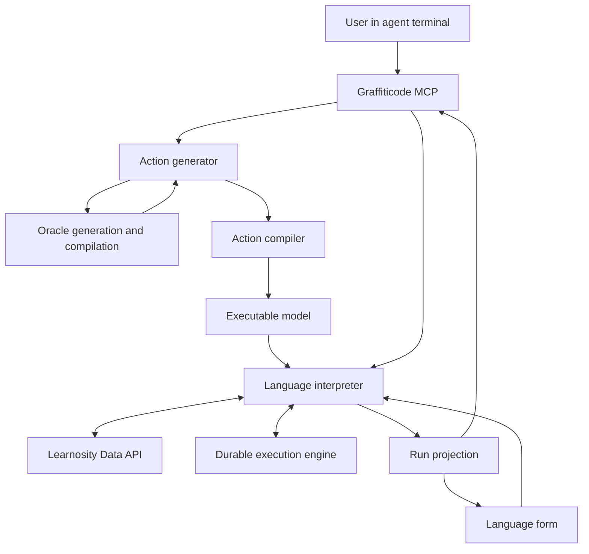

**Status:** Proposed design, summarizing the conversation of November 3, 2026.

**Working language name:** Learnosity Data Operations. **Language ID:** Unassigned.

**Design basis:** The user delegates a Learnosity data operation through an agent terminal. Graffiticode prepares and executes it, maintains durable progress, and presents the outcome. This document separates requirements established in the discussion from proposed implementation choices and decisions still open.

# Purpose

Introduce a Graffiticode action language for Learnosity operations that can outlive an individual API request, agent session, or browser session. The proposed initial scope is the Data API, which became the focus of the discussion. The language should support both asynchronous provider jobs and operations composed of many smaller requests. Its execution model should also accommodate future workflows that wait for people or coordinate several dependent operations. The same interpreter architecture can support other Learnosity APIs through appropriate language capabilities and adapters.

The product promise is that a user can request an outcome, such as rescoring a cohort, updating selected Item Bank content, or generating a dataset, and delegate responsibility for completing that operation. Graffiticode should either verify the requested outcome or preserve an explicit, recoverable account of why completion is blocked or partial.

The central architecture is:

> The action generator consults the API oracle inline, generates executable language code from its guidance, and passes that code through a validating compiler. The language interpreter executes the resulting model with support from a durable execution engine. The form presents the operation, its progress, and its results.

Oracle consultation during development is already supported. The new requirement is consultation during preparation of each requested action. A completed recipe is an internal input to execution; the user expects the operation itself to be done.

# Requirements established in the discussion

1. **One user request can initiate the whole operation.** The terminal agent calls Graffiticode MCP, which coordinates preparation and execution. An explicit execution start in the protocol does not require another user confirmation when the original request already authorizes the operation.

2. **The action generator invokes the oracle inline.** It needs a callable dependency on the oracle generation and compilation pipeline. The terminal agent should not have to manually build an oracle item, interpret its recipe, and construct a second program.

3. **The compiler and interpreter have distinct responsibilities.** For this new language, compilation produces a validated executable model; interpretation performs external effects. This proposal does not imply that existing languages have already adopted that boundary.

4. **Normal execution follows the compiled model.** Paging, polling, retries, and routine recovery do not require a new LLM or oracle decision at every step.

5. **Execution survives disconnection.** The agent terminal and form can detach and later reconnect to the same run.

6. **The form shows meaningful operation state.** It presents scope, progress, confirmed results, exceptions, and valid actions throughout execution.

7. **Completion has a domain meaning.** An HTTP response or accepted provider job is evidence of progress. Completion requires the postconditions defined for the requested operation.

8. **Uncertainty remains visible.** Partial success, ambiguous writes, unsupported capabilities, and unresolved semantic questions cannot be presented as completed work.

The working language name, exact source syntax, engine, storage, operation inventory, and wire protocols remain design choices.

# Architecture and ownership

The design uses existing Graffiticode concepts: a task pairs a language with code, and a model pairs a language with compiled data. An execution is a separate instance of interpreting a particular model revision. An authoring item can retain task revisions while multiple executions refer to the same compiled model.

**This language has one logical interpreter.** It supplies the meaning of the compiled operations and uses a durable execution engine for persistence, scheduling, and recovery. **Durable interpretation** names the resulting behavior. One logical interpreter means one language contract and semantic interface; multiple workers or replicas can execute that contract.

The diagram shows responsibility and data flow, not a required service deployment. The oracle pipeline, compiler, interpreter, and adapter can share libraries or processes where useful.

| Component | Responsibility |
| - | - |
| Terminal agent | Interpret the user’s intent, supply available context, delegate through MCP, and report the operation’s status and outcome. |
| Graffiticode MCP | Expose action preparation and execution, return run identity, and support later status reads and commands. |
| Action generator | Invoke the relevant oracle inline, consume the returned guidance, and generate code in the action language. |
| API oracle | Supply checked operational guidance, constraints, examples, evidence, and uncertainty for the requested API operation. |
| Action compiler | Validate source, supported capabilities, static inputs, effects, and model structure. Produce a versioned executable model. |
| Language interpreter | Interpret the model and apply Learnosity semantics through its API adapter: requests, preservation rules, pagination, job interpretation, reconciliation, and outcome checks. |
| Durable execution engine | Maintain the authoritative execution record, schedule work and timers, resume interpreter-owned handlers, coordinate dependencies, and enforce concurrency controls. |
| Form | Render the run projection and submit supported commands through the execution interface. |

The Learnosity API adapter is a module within the language interpreter. The durable execution engine provides reusable persistence and scheduling support across languages. These responsibilities can be implemented as separate modules without requiring separate network services.

## Interpreter behaviors

The shared interpreter design supports three behaviors. These describe how interpretation proceeds and do not require three separate services.

| Behavior | Meaning |
| - | - |
| Identity | Return the model data without further evaluation. |
| Immediate | Evaluate now and return a result, such as refreshed presentation credentials. |
| Durable | Start or resume an identified execution whose state survives the current request or process. |

A language can combine these behaviors. Producing the current projection of a durable run may require an immediate signature refresh; the refresh leaves the run identity and progress unchanged. Durable behavior concerns execution guarantees, regardless of elapsed time. A quickly completed operation can still need durable handling for restarts, lost acknowledgements, or retries.

# Inline oracle delegation

## Preparation flow

The action generator receives the user’s intended outcome, target connection and scope, supplied parameters, relevant constraints, and the inventory of operations the runtime can actually execute. It then invokes the appropriate oracle pipeline as a tool or internal dependency.

That invocation includes both **generation and compilation**. Calling only an oracle code generator would return oracle-language source. The action generator needs the resulting specification or recipe, with validation findings and uncertainties. The current L0178 Data API oracle is a guidance source; this new design gives another generator a direct way to consume its completed output.

The caller uses the oracle result together with its own language specification to generate action-language code. The action compiler independently checks that code against supported operations and permitted effects. A complex request may require several oracle consultations before producing one executable model.

The proposed internal result envelope should include the recipe or specification, required inputs, relevant operation references, preservation and completion requirements, warnings, evidence provenance, and the oracle or contract version used. Existing prose guidance can be carried within this envelope. It does not become executable simply because it is structured or validated.

An inline call does not necessarily mean a fresh documentation crawl or live Learnosity experiment for every request. Invocation, knowledge refresh, and caching are separate policies. Cached guidance must remain applicable to the requested operation and supported contract version.

## Resolving missing information

The generator should distinguish four kinds of missing information:

| Missing information | Resolution |
| - | - |
| Facts already available in the request or connection context | Supply them internally. |
| Current provider state, such as session status or the selected item population | Represent runtime reads and preconditions in the model. |
| A genuine user choice, such as whether to overwrite a conflicting result | Ask only when the choice is necessary and not already authorized. |
| Uncertain API semantics | Use the oracle and its evidence; surface unresolved support limitations. |

This separation avoids asking the user to provide vendor knowledge while also avoiding the assumption that a recipe knows current remote state.

## Boundaries

**Oracle guidance cannot create runtime capabilities that the interpreter does not implement.** A valid recipe for an unsupported operation must produce an explicit unsupported-capability result during preparation or compilation.

Routine interpretation uses the pinned model and implemented operation contracts. If execution reveals a contract mismatch, the run retains its state and diagnostics. A subsequent repair may consult the oracle again, generate revised code, validate it, and explicitly associate the repair with the existing operation. Automatic runtime replanning remains a possible later capability; it is not the normal execution loop.

# Language semantics

The language should describe a requested business operation, its scope, dependencies, constraints, and completion conditions at a level the interpreter can validate and execute. It should expose a supported vocabulary of Learnosity operations rather than unrestricted arbitrary HTTP execution.

The following is a proposed semantic model, not finalized source syntax or a claim about an existing implementation:

| Model element | Meaning |
| - | - |
| Intent | The outcome the user delegated. |
| Connection reference | The authorized Learnosity account, environment, and relevant bank context. |
| Scope | Explicit references or a bounded selection rule, with a policy for resolving and retaining the target population. |
| Operation | A versioned, implemented action and its typed arguments. |
| Preconditions | Static checks and runtime conditions that must hold before effects occur. |
| Dependencies | Ordering and data flow between operations. |
| Preservation rules | Information that must remain intact when a write changes part of a resource. |
| Completion criteria | Evidence required to classify each target and the overall run. |
| Recovery policy | Retry classification, reconciliation, limits, and permitted corrective actions. |
| Result contract | Records, artifacts, exceptions, and domain information exposed to MCP and the form. |

Useful execution constructs include bounded selection, pagination, batching, asynchronous job submission and waiting, per-target verification, artifact retrieval, and durable waits for authorized input. Some belong in source syntax; others can be expanded by trusted operation implementations. That boundary should keep common programs concise while preserving checkpoint visibility.

Long-running transaction means a durable sequence of effects with explicit recovery. The language does not promise distributed database atomicity across Learnosity requests. Rollback, compensation, and cancellation must be defined for each supported operation.

# Compilation and operation contracts

The new language’s compiler should be deterministic for its source and pinned inputs. It validates types, required arguments, operation availability, effect declarations, dependency structure, and statically knowable constraints. It also identifies runtime checks needed before execution.

A supplied session reference does not prove that the session is currently Completed. A compiled selection expression does not establish a frozen remote snapshot. Such conditions remain runtime obligations unless verified input data with an appropriate freshness policy is explicitly supplied.

The proposed implementation uses a versioned operation package to connect three views of the same capability:

1. Guidance available to the oracle and action generator.

2. Compiler validation and model construction.

3. Runtime handlers, verification, and reconciliation.

Each supported operation should define its inputs and effects, preconditions, request and response protocol, pagination or job behavior, completion evidence, retry rules, and known limitations. Evidence should distinguish documented behavior from behavior established by tests under identified conditions and behavior still unconfirmed.

These definitions can combine schemas, trusted code, documentation, and conformance tests. The design does not require every API semantic rule to be expressed in a single declarative format. A shared Rust library may fit the compiler direction discussed; packaging and deployment remain open.

Runs should pin the compiled model and compatible operation implementation versions. Updating an oracle, compiler, or adapter must not silently change the semantics of an execution already in progress.

# Durable execution

## Identity and persistence

The runtime needs distinct identifiers for the task or model revision, execution, initiating command, step and attempt, and provider job or affected resource. A model can be executed more than once. Repeating a start command with the same command identity should return the existing run rather than create another operation.

The engine maintains one authoritative execution record. The language interpreter derives domain state and form projections from that record. The record should retain the selected targets, relevant source versions or content, step states, request intent, provider references, confirmed outcomes, unresolved outcomes, retry schedules, and result locations. Sensitive data retention should be scoped to what execution and verification require.

Before dispatching an external effect, the runtime records enough intent to recover. After receiving an outcome, it records the evidence needed for the next transition. A crash between provider acceptance and receipt persistence produces an uncertain outcome; it does not prove that the request failed.

Handlers must expose meaningful checkpoint boundaries. An opaque function that performs twenty writes before returning deprives the engine of the information needed to recover those writes individually.

## Retries and reconciliation

Retry safety is operation-specific. Reads, polling, writes with documented idempotency, and writes with ambiguous outcomes require different handling. The engine provides timers and attempts; the adapter decides what a repeated call means.

A local idempotency key or request hash can prevent duplicate local dispatch decisions. It cannot manufacture exactly-once effects in a remote API that lacks the necessary guarantees. When acknowledgement is lost, the adapter should inspect available provider state, reconcile against the desired outcome, and retry only when the contract supports doing so safely.

Verification may establish that the desired state exists without proving which actor produced it. Results should distinguish already satisfied targets, confirmed changes, and unconfirmed outcomes where that distinction matters.

## Selection and concurrency

For cohort operations, the proposed default is to resolve and retain a bounded target population before effects begin. Large discoveries can checkpoint their cursor and discovered references. Operations that intentionally follow a changing population must declare that behavior and a termination policy.

Source definitions used for an operation must also have an explicit consistency policy. Saving a hash or performing a preflight read does not lock Learnosity content. The adapter must either use a supported stable source, detect conflicts, or apply the declared conflict policy.

Concurrency and rate limits should be shared across runs that use the same relevant connection and endpoint. Durable timers should release workers while a run waits. Retry limits and backoff should remain visible in the execution state. Learnosity documents both general and endpoint-specific limits; the operational contract must encode the applicable rules. [Rate limiting](https://help.learnosity.com/hc/en-us/articles/360000758677-Rate-Limiting-With-the-Data-API).

## Credentials and authority

Models contain connection references and declared effects. Credentials are resolved and requests signed when the relevant action occurs. Long-lived models should not embed secrets or short-lived signed requests.

The runtime enforces the scope already authorized by the user’s request. Oracle advice supplies knowledge, not authority. A repair that changes the requested scope or effects needs a new authorization decision; routine continuation within the existing request does not.

## Completion and stopping

Completion is evaluated at both target and run level. A provider job can finish while some records were skipped or failed. A generated dataset can require download and retention before the requested export is complete. Downstream delivery requires an acknowledgement if that delivery is part of the user’s requested outcome.

A stop command should prevent additional dispatch where possible and preserve the current account of effects. Submitted remote jobs may continue, and completed writes remain completed. The form must expose only cancellation or corrective actions actually supported by the operation contract.

# Execution interface and lifecycle

The proposed interpreter interface has three conceptual operations:

| Operation | Behavior |
| - | - |
| Start | Create or recover a run for a compiled model under a command identity and authorized execution context. |
| Read | Return the current projection, confirmed results, exceptions, and available actions for a run. |
| Dispatch | Submit a supported command or signal, such as providing missing input, reconciling an uncertain step, or stopping further work. |

The proposed `/interpret` interface is the entry point to the language interpreter. For durable behavior, a start command creates or recovers an identified run through the engine; a read returns the current projection of that run. Repeating a start command uses the same command identity to recover the existing run. Exact paths, tool names, request schemas, and response shapes remain open. MCP can combine preparation, compilation, and start in one action-oriented call while retaining these distinct internal responsibilities.

## Interpreter and engine handoff

Consider an operation that submits a Learnosity job and must wait for its result:

1. The language interpreter validates the execution request against the compiled model and authorized context, then submits the identified run to the engine.

2. The engine persists and schedules the run, invoking the interpreter’s pinned operation handlers. Those handlers retain Learnosity-specific request, completion, and recovery semantics.

3. Before dispatch, the handler records request intent through the engine. It submits the work through its Learnosity API adapter, then records the acknowledged outcome and any returned provider job reference. A missing acknowledgement follows the operation’s reconciliation policy.

4. When the interpreter reaches a waiting point, the engine records the next observation time and releases the worker. When due, it invokes the appropriate interpreter handler to observe the job and interpret the response.

5. The interpreter determines the next domain transition: wait again, process results, submit another batch, reconcile uncertainty, or complete the run. The engine persists and schedules that transition.

Normal resumption invokes the pinned interpreter handlers. Oracle consultation and action generation remain part of preparing the executable model, or of an explicit semantic repair. Reading status, reopening the form, or refreshing presentation credentials observes the existing run; those reads do not themselves start or advance workflow work.

## Run lifecycle

A proposed run lifecycle includes ready, running, waiting, needs input, needs reconciliation, completed, completed with exceptions, failed, stop requested, and stopped. The final state enum should be driven by supported operations. Completion with exceptions is valid only when the operation’s policy permits that outcome.

Preparation is a separate visible phase before an executable run is ready. The same component can represent preparation, execution, and results without claiming that API effects began during generation.

Human workflow steps can use durable signals correlated to the run and target work item. They require explicit authority, expiration behavior, and a continuation rule. This enables future review or grading workflows without assuming that every vendor API supplies native approval or callback capabilities.

# Form behavior

The form is a live, language-specific view of the requested operation. Its main content should remain understandable without reading source code, oracle guidance, or engine internals.

A stable header identifies the operation, connection or environment, target scope, important constraints, and execution. The body changes as the run progresses:

| Phase | What the user sees |
| - | - |
| Preparing | The requested outcome and preparation status. Missing choices or support limitations appear here. |
| Discovering | The selection being evaluated and records found so far. A percentage appears only when a credible total is known. |
| Running | Current domain phase, confirmed progress, partial results, and remaining work. Submitted and verified counts remain distinguishable. |
| Waiting | What is being awaited, the last observation time, and a credible next check or estimate when available. |
| Needs attention | The concrete issue, affected records, preserved progress, and supported choices or recovery actions. |
| Completed | A persistent result with affected records, changes, artifacts, and any permitted exceptions. |
| Failed or stopped | What completed, what remains, any ongoing remote work, and available next actions. |

The shared frame should support domain-specific result bodies: item changes for bank maintenance, session outcomes for rescoring, downloadable files for datasets, and review state for human workflows. Oracle consultations, generated source, execution history, and diagnostics belong in an optional details surface.

## Projection contract

The interpreter supplies a projection containing run and model identity, current phase and state, known scope, verified progress, confirmed results, exceptions, valid authorized actions, and freshness information. It may also contain temporary presentation credentials or references that the API resolves for display.

Workflow transitions update or invalidate the API’s cached projection. That cache is a read model, not the durable execution record. Refreshing a Learnosity signature or an expiring result link must leave run identity and progress unchanged.

Opening or refreshing the form attaches to an existing run. It must never implicitly restart execution. If one model has several runs, routing or a run selector must make the selected execution explicit. Form buttons and MCP commands use the same execution command interface; the form does not independently perform Data API writes.

The [illustrative operation form](https://chatgpt.com/library?file_id=libfile_48ac498819788191a4828a59df00b3dd\&account_id=4a3d4b44-aabd-45f6-af0d-94e6f511ad10) from the conversation demonstrates running, uncertain, completed, and stopped states. Its records and progress are simulated; it is not a live execution or implemented language.

# Learnosity use cases

These use cases establish why durable interpretation is useful. They are candidates for the language’s supported inventory, not a commitment to implement every operation in the first release.

| Use case | Durable work | Important operational contract |
| - | - | - |
| Rescore a defined cohort | Resolve sessions, check eligibility, submit batches, retain job references, poll, and classify outcomes. | The documented update and rescore endpoint accepts up to 100 sessions, requires Completed sessions and compatible question structure, and returns an asynchronous job. Its result can include skipped sessions or scoring errors. [Endpoint](https://help.learnosity.com/hc/en-us/articles/26076318688925-Update-and-re-score-Item-Endpoints-Data-API). |
| Generate a dataset | Initialize, upload required input files when applicable, start generation, poll, retrieve, and retain outputs. | Dataset creation has a distinct initialization and job lifecycle. Input upload URLs expire; replacement can require a new dataset identity while retaining the same business run. [Lifecycle](https://help.learnosity.com/hc/en-us/articles/360000758557-Implementing-and-Creating-Datasets-for-Download-or-Reporting), [reports endpoint](https://help.learnosity.com/hc/en-us/articles/26076304360861-Reports-Endpoints-Data-API). |
| Maintain an Item Bank | Page through a selection, calculate changes, write bounded batches, and verify preservation and results. | Read and write limits, pagination, and merge or replacement behavior must be encoded for the exact action. The documented items endpoint limits batches to 50 items. [Items endpoint](https://help.learnosity.com/hc/en-us/articles/26076386828189-Items-Endpoints-Data-API). |
| Prepare an assessment release | Wait for review outcomes, create a content snapshot, and track dependencies before release. | Learnosity review workflow and Item Pools have their own semantics. Pools capture snapshots; later explicit updates can change them. [Review workflow](https://help.learnosity.com/hc/en-us/articles/360006127638-Item-Review-Workflow), [Item Pools](https://help.learnosity.com/hc/en-us/articles/360000755878-Using-Item-Pools-to-Create-Content-Snapshots). |
| Complete grading or closeout | Wait for required human work, submit score or status updates, and verify final outcomes. | Score updates can be asynchronous. Session completion, manual grading completion, and preventing further access are separate concerns. [Response scores](https://help.learnosity.com/hc/en-us/articles/26076278639389-Response-scores-Endpoints-Data-API), [session lifecycle](https://help.learnosity.com/hc/en-us/articles/360002842798-Lifecycle-of-a-Learnosity-Session). |
| Build an offline package or recover submissions | Submit supported jobs, retain their references, and retrieve or verify outcomes. | These are distinct Data API workflows with their own eligibility and payload requirements. [Offline package endpoint](https://help.learnosity.com/hc/en-us/articles/26076363707421-Local-device-assessment-Endpoints-Data-API), [failed submissions](https://help.learnosity.com/hc/en-us/articles/26076336091933-Failed-submissions-Endpoints-Data-API). |

The shared jobs interface helps standardize polling, but business success remains operation-specific. [Jobs endpoints](https://help.learnosity.com/hc/en-us/articles/26076318439197-Jobs-Endpoints-Data-API).

Pagination also belongs in each operation contract. Endpoint families differ in how continuation is signaled; a single assumption that a returned cursor always proves another nonempty page exists is insufficient. [Responses endpoint](https://help.learnosity.com/hc/en-us/articles/26076304385565-Responses-Endpoints-Data-API).

Cross-system result delivery is a future extension requiring an explicit destination adapter and acknowledgement policy. Learnosity’s Data API Firehose uses Amazon Kinesis for session events and scores; it should not be treated as a generic job-completion webhook. [Firehose documentation](https://help.learnosity.com/hc/en-us/articles/360000755938-Using-Amazon-Kinesis-to-Stream-Session-Events-and-Scores).

# Worked example

Consider the illustrative request: “Add the Spring review tag to the Grade 5 science items in the Science bank, preserving their existing tags.” The following describes intended behavior, conditional on a verified implementation of that preservation contract.

1. The terminal agent sends the requested outcome and connection context through Graffiticode MCP.

2. The action generator invokes the Data API oracle pipeline for selection, tag preservation, write behavior, and completion checks. It consumes the compiled guidance and generates code using supported action operations.

3. The action compiler checks the operation, scope, inputs, and effects. The authorized request starts a run with a stable identity.

4. The interpreter discovers and retains 240 selected items. It records that 10 already satisfy the requested condition and applies verified changes to the others in supported batches.

5. At one observation, 150 items have confirmed updates, 10 already satisfy the condition, and 80 remain. The form reports 160 of 240 verified, preserving the distinction between changed and already satisfied.

6. Later, the last 10 writes have been submitted but their acknowledgements are unavailable. The run reports 230 verified and 10 unconfirmed. It enters reconciliation rather than claiming success or blindly repeating those writes.

7. Supported read-back checks establish whether the remaining targets now satisfy the requested condition. If they do, a final result can report 220 confirmed updates, 10 reconciled to the desired state, and 10 already satisfied. Reporting all 230 as confirmed updates requires stronger evidence that resolves attribution. If verification cannot establish the requested state, the run retains the unresolved records and exposes an appropriate next action.

The agent and form can disconnect during this sequence. Reopening either surface retrieves the same run and its current projection. A stop request preserves confirmed results and identifies unprocessed or still-running remote work.

# Proposed delivery plan

First implement the complete path for one supported operation: inline oracle delegation, validated model generation, durable execution, status retrieval, and a useful form. This tests the product contract more directly than building a broad workflow vocabulary before any operation can complete.

A defined-cohort rescore is a strong first product demonstration because it exercises preconditions, batching, asynchronous jobs, long waits, partial outcomes, and meaningful verification. Dataset generation is a strong next operation because it adds input and output artifacts, expiration, and retrieval. A narrower provider job can serve as an earlier engineering pilot if it reduces implementation risk.

Bulk Item Bank maintenance should follow once preservation semantics and reconciliation are supported by adequate evidence and tests. Human review, grading coordination, and cross-system delivery can then extend the same durable execution model with signals and additional adapters.

For the initial engine, a persisted state machine is a viable implementation proposal. A separate workflow engine can supply the same responsibilities if warranted. The language contract should not depend on choosing that technology first.

# Acceptance criteria

The initial supported operation should demonstrate the following behaviors:

- A user delegates an action once; Graffiticode invokes the oracle pipeline within action generation, then either starts a validated run or reports a specific preparation failure.

- A valid oracle recipe for an unimplemented capability is rejected before external effects.

- A worker restart during a wait or between completed steps resumes the same run without losing its provider references or confirmed outcomes.

- Repeating an initiating command does not create a duplicate run; an intentional second execution receives a separate run identity.

- A lost acknowledgement produces reconciliation or explicit uncertainty, with retries governed by the operation contract.

- Pagination exhausts the declared scope, and concurrency respects shared connection limits.

- A provider job with record-level exceptions cannot be reported as unqualified success.

- Changing the task, oracle, or adapter version does not silently alter an existing execution.

- Refreshing the form, cached projection, signature, or download link does not restart work.

- Stopping accurately reports completed effects, remaining work, and remote jobs that may still be active.

- The final form and MCP result retain the evidence and artifacts needed to understand the outcome.

# Decisions still open

| Decision | Direction recorded in this document |
| - | - |
| Language identity and source syntax | Use Learnosity Data Operations as a working name; assign the language ID and finalize grammar separately. |
| Initial operation inventory | Start with one complete operation; rescoring is the proposed first substantial demonstration. |
| Oracle invocation interface | Provide a callable generation-and-compilation dependency returning completed guidance; finalize schema, caching, and version compatibility. |
| Operation package | Align oracle guidance, compiler validation, runtime handlers, evidence, and tests; choose repository and library boundaries. |
| Engine and storage | Preserve the durable contract; choose a persisted state machine or workflow engine and its backing store. |
| Execution API and MCP tools | Define start, read, and dispatch semantics; finalize endpoint names, command identity, and run handles. |
| Source and cohort consistency | Specify freezing, conflict detection, and dynamic-scope policies per operation. |
| Form transport and routing | Choose polling or subscriptions and make model revision and selected run explicit. |
| Connections and authority | Finalize credential resolution and how authorized scope and effects are represented. |
| Repair and cancellation | Define supported reconciliation and stopping behavior per operation; keep automatic semantic replanning outside the initial normal loop. |
| Promotion into executable support | Establish evidence and conformance requirements for each operation before the compiler accepts it. |
