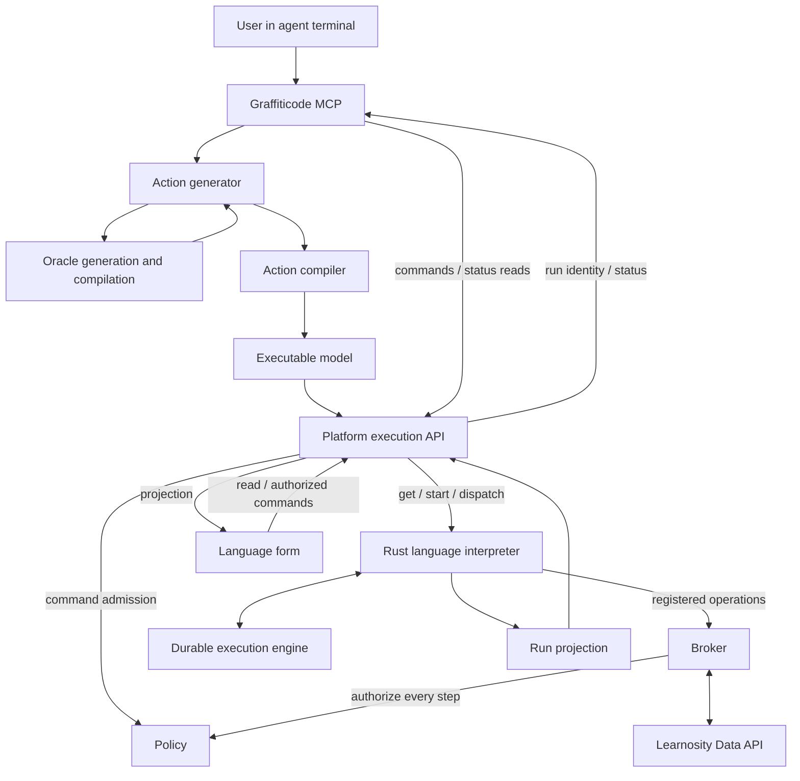

**Status:** Proposed design, summarizing the conversation of November 3, 2026.

**Working language name:** Learnosity Data Operations. **Language ID:** L0188.

**Design basis:** The user delegates a Learnosity data operation through an agent terminal. Graffiticode prepares and executes it, maintains durable progress, and presents the outcome. This document separates requirements established in the discussion from proposed implementation choices and decisions still open.

# Purpose

Introduce a Graffiticode action language for Learnosity operations that can outlive an individual API request, agent session, or browser session. The proposed initial scope is the Data API, which became the focus of the discussion. The language should support both asynchronous provider jobs and operations composed of many smaller requests. Its execution model should also accommodate future workflows that wait for people or coordinate several dependent operations. The same interpreter architecture can support other Learnosity APIs through appropriate language capabilities and adapters.

The product promise is that a user can request an outcome, such as rescoring a cohort, updating selected Item Bank content, or generating a dataset, and delegate responsibility for completing that operation. Graffiticode should either verify the requested outcome or preserve an explicit, recoverable account of why completion is blocked or partial.

The central architecture is:

> The action generator consults the API oracle inline, generates executable language code from its guidance, and passes that code through a validating compiler. The language interpreter executes the resulting model with support from a durable execution engine. The form presents the operation, its progress, and its results.

Oracle consultation during development is already supported. The new requirement is consultation during preparation of each requested action. A completed recipe is an internal input to execution; the user expects the operation itself to be done.

L0188 is the first workflow language to require the durable-execution extension outlined in the [interpreter design](graffiticode-interpreter-design.md). It inherits the platform's compilation, command, capability, and recovery contracts from that design and the [interpreter implementation plan](graffiticode-interpreter-plan.md). Its engine and language-specific handlers extend that execution system; they do not create a second command or effect path.

# Requirements established in the discussion

1. **One user request can initiate the whole operation.** The terminal agent calls Graffiticode MCP, which coordinates preparation and execution. An explicit execution start in the protocol does not require another user confirmation when the original request already authorizes the operation.

2. **The action generator invokes the oracle inline.** It needs a callable dependency on the oracle generation and compilation pipeline. The terminal agent should not have to manually build an oracle item, interpret its recipe, and construct a second program.

3. **The compiler and interpreter have distinct responsibilities.** For this new language, compilation produces a validated executable model; interpretation performs external effects. This proposal does not imply that existing languages have already adopted that boundary.

4. **Normal execution follows the compiled model.** Paging, polling, retries, and routine recovery do not require a new LLM or oracle decision at every step.

5. **Execution survives disconnection.** The agent terminal and form can detach and later reconnect to the same run.

6. **The form shows meaningful operation state.** It presents scope, progress, confirmed results, exceptions, and valid actions throughout execution.

7. **Completion has a domain meaning.** An HTTP response or accepted provider job is evidence of progress. Completion requires the postconditions defined for the requested operation.

8. **Uncertainty remains visible.** Partial success, ambiguous writes, unsupported capabilities, and unresolved semantic questions cannot be presented as completed work.

The working language name, exact source syntax, engine, storage, operation inventory, and detailed wire schemas remain design choices. Rust language implementation, platform command admission, Policy/Broker mediation, and the guarantees below are inherited requirements.

# Architecture and ownership

The design uses existing Graffiticode concepts: a task pairs a language with code, and a model pairs a language with compiled data. An execution is a separate instance of interpreting a particular model revision. An authoring item can retain task revisions while multiple executions refer to the same compiled model.

**This language has one logical interpreter.** It supplies the meaning of the compiled operations and uses a durable execution engine for persistence, scheduling, and recovery. **Durable interpretation** names the resulting behavior. One logical interpreter means one language contract and semantic interface; multiple workers or replicas can execute that contract.

The diagram shows responsibility and data flow, not a required service deployment. The oracle pipeline, compiler, interpreter, and adapter can share libraries or processes where useful. Compiler/interpreter service traffic remains subject to the platform's egress controls, omitted here for clarity. Broker's provider connection is separate from compiler egress.

| Component | Responsibility |
| - | - |
| Terminal agent | Interpret the user’s intent, supply available context, delegate through MCP, and report the operation’s status and outcome. |
| Graffiticode MCP | Expose action preparation and execution, return run identity, and support later status reads and commands. |
| Platform execution API | Accept public commands, allocate their identity and admission, route to pinned language revisions, and authorize reads of selected runs. |
| Action generator | Invoke the relevant oracle inline, consume the returned guidance, and generate code in the action language. |
| API oracle | Supply checked operational guidance, constraints, examples, evidence, and uncertainty for the requested API operation. |
| Action compiler | Validate source, supported capabilities, static inputs, effects, and model structure. Produce a versioned executable model. |
| Language interpreter | Interpret the model and apply Learnosity semantics: preservation rules, pagination, job interpretation, reconciliation, and outcome checks. Its language-side adapter prepares registered Broker operations and interprets their results. |
| Durable execution engine | Maintain the authoritative execution record, schedule work and timers, resume pinned interpreter-owned handlers, coordinate dependencies, and enforce ownership leases and fencing. |
| Policy | Admit commands against model digests and registered capabilities; mint scoped tokens and re-check live authority and fencing before each protected execution step. |
| Broker | Validate scoped operations and arguments, claim receipts, reauthorize each step with Policy, and perform provider requests and signing with backend credentials. |
| Form | Render the run projection and submit supported commands through the execution interface. |

The language-side Learnosity adapter is a module within the Rust interpreter. It supplies domain semantics and calls registered Broker operations; Broker's provider adapter performs the signed HTTP requests. The language workers do not receive Learnosity backend secrets or bypass Broker. The durable execution engine provides reusable persistence and scheduling support across languages. These responsibilities can be implemented as separate modules without requiring separate network services.

## Interpreter behaviors

The shared interpreter design supports three behaviors. These describe how interpretation proceeds and do not require three separate services.

| Behavior | Meaning |
| - | - |
| Identity | Return the model data without further evaluation. |
| Immediate | Evaluate now and return a result, such as refreshed presentation credentials. |
| Durable | Start or resume an identified execution whose state survives the current request or process. |

A language can combine these behaviors. Producing the current projection of a durable run may require an immediate signature refresh; the refresh leaves the run identity and progress unchanged. Durable behavior concerns execution guarantees, regardless of elapsed time. A quickly completed operation can still need durable handling for restarts, lost acknowledgements, or retries.

# Inline oracle delegation

## Preparation flow

The action generator receives the user’s intended outcome, target connection and scope, supplied parameters, relevant constraints, and the inventory of operations the runtime can actually execute. It then invokes the appropriate oracle pipeline as a tool or internal dependency.

That invocation includes both **generation and compilation**. Calling only an oracle code generator would return oracle-language source. The action generator needs the resulting specification or recipe, with validation findings and uncertainties. The current L0178 Data API oracle is a guidance source; this new design gives another generator a direct way to consume its completed output.

The caller uses the oracle result together with its own language specification to generate action-language code. The action compiler independently checks that code against supported operations and permitted effects. A complex request may require several oracle consultations before producing one executable model.

The proposed internal result envelope should include the recipe or specification, required inputs, relevant operation references, preservation and completion requirements, warnings, evidence provenance, and the oracle or contract version used. Existing prose guidance can be carried within this envelope. It does not become executable simply because it is structured or validated.

An inline call does not necessarily mean a fresh documentation crawl or live Learnosity experiment for every request. Invocation, knowledge refresh, and caching are separate policies. Cached guidance must remain applicable to the requested operation and supported contract version.

## Resolving missing information

The generator should distinguish four kinds of missing information:

| Missing information | Resolution |
| - | - |
| Facts already available in the request or connection context | Supply them internally. |
| Current provider state, such as session status or the selected item population | Represent runtime reads and preconditions in the model. |
| A genuine user choice, such as whether to overwrite a conflicting result | Ask only when the choice is necessary and not already authorized. |
| Uncertain API semantics | Use the oracle and its evidence; surface unresolved support limitations. |

This separation avoids asking the user to provide vendor knowledge while also avoiding the assumption that a recipe knows current remote state.

## Boundaries

**Oracle guidance cannot create runtime capabilities that the interpreter does not implement.** A valid recipe for an unsupported operation must produce an explicit unsupported-capability result during preparation or compilation.

Routine interpretation uses the pinned model and implemented operation contracts. If execution reveals a contract mismatch, the run retains its state and diagnostics. Reconciliation and replay repair follow the platform rules below. Generating revised code is a distinct semantic repair: it cannot replace the model of an existing command or start the remaining work as an ordinary new command. That extension requires its own admitted, linked repair protocol before it is supported. Automatic runtime replanning is outside the initial execution loop.

# Language semantics

The language should describe a requested business operation, its scope, dependencies, constraints, and completion conditions at a level the interpreter can validate and execute. It should expose a supported vocabulary of Learnosity operations rather than unrestricted arbitrary HTTP execution.

The following is a proposed semantic model, not finalized source syntax or a claim about an existing implementation:

| Model element | Meaning |
| - | - |
| Intent | The outcome the user delegated. |
| Connection reference | The authorized Learnosity account, environment, and relevant bank context. |
| Scope | Explicit references or a bounded selection rule, with a policy for resolving and retaining the target population. |
| Operation | A versioned, implemented action and its typed arguments. |
| Preconditions | Static checks and runtime conditions that must hold before effects occur. |
| Dependencies | Ordering and data flow between operations. |
| Preservation rules | Information that must remain intact when a write changes part of a resource. |
| Completion criteria | Evidence required to classify each target and the overall run. |
| Recovery policy | Retry classification, reconciliation, limits, and permitted corrective actions. |
| Result contract | Records, artifacts, exceptions, and domain information exposed to MCP and the form. |

Useful execution constructs include bounded selection, pagination, batching, asynchronous job submission and waiting, per-target verification, artifact retrieval, and durable waits for authorized input. Some belong in source syntax; others can be expanded by trusted operation implementations. That boundary should keep common programs concise while preserving checkpoint visibility.

Long-running transaction means a durable sequence of effects with explicit recovery. The language does not promise distributed database atomicity across Learnosity requests. Rollback, compensation, and cancellation must be defined for each supported operation.

# Compilation and operation contracts

The new language’s compiler should be deterministic for its source and pinned inputs. It validates types, required arguments, operation availability, effect declarations, dependency structure, and statically knowable constraints. It also identifies runtime checks needed before execution.

A supplied session reference does not prove that the session is currently Completed. A compiled selection expression does not establish a frozen remote snapshot. Such conditions remain runtime obligations unless verified input data with an appropriate freshness policy is explicitly supplied.

The proposed implementation uses a versioned operation package to connect three views of the same capability:

1. Guidance available to the oracle and action generator.

2. Compiler validation and model construction.

3. Runtime handlers, verification, and reconciliation.

Each supported operation should define its inputs and effects, preconditions, request and response protocol, pagination or job behavior, completion evidence, retry rules, and known limitations. Evidence should distinguish documented behavior from behavior established by tests under identified conditions and behavior still unconfirmed.

These definitions can combine schemas, trusted code, documentation, and conformance tests. The design does not require every API semantic rule to be expressed in a single declarative format. Implement the compiler and language interpreter in Rust using the shared language contract. A shared Rust operation library may hold their common definitions; engine technology, packaging, and deployment remain open. The operation package must agree with the authoritative protected-function registry and Broker implementation. Oracle guidance or a compiler declaration cannot register or authorize a new provider operation by itself.

Each admitted command pins the ordered stage model digests, relevant configuration, interpreter revision and retained tag URL, operation implementation versions, and admitted `REGISTRY_VERSION`. Compatibility with a newer implementation is not permission to resume on it: retries and worker wakeups use the recorded revisions and inputs. Updating an oracle, compiler, or adapter does not change an existing command. A semantic repair or implementation migration requires an explicit protocol and admission; it never silently rewrites those bindings.

Pinned revisions and their required dependencies remain available while runs need them. Registry expand/contract follows P1b: a live run that still needs new effects must retain a supported authorization contract or pause for an explicit migration decision. A replay-only token can return an old receipt, but cannot authorize continuation work.

# Durable execution

## Identity and persistence

The runtime needs distinct identifiers for the task or model revision, execution, initiating command, step and attempt, and provider job or affected resource. A model can be executed more than once. Start requires a caller-supplied idempotency key scoped to the initiating principal. Repeating `(uid, idempotencyKey)` returns the existing command and run identity; changing its task, connection, input digest, or admitted model digests is a conflict.

Allocation is atomic under Policy's command protocol (B5/D2a). Concurrent requests with the same key get the winning command/run binding; a preliminary lookup never decides ownership or protocol. Each dispatch command also has its own idempotency key bound to the selected run and command payload. Ordinary retries reuse the accepted bindings rather than regenerating code or allocating a fresh execution.

The engine maintains one authoritative execution record. The language interpreter derives domain state and form projections from that record. The record should retain the selected targets, relevant source versions or content, step states, request intent, provider references, confirmed outcomes, unresolved outcomes, retry schedules, and result locations. Sensitive data retention should be scoped to what execution and verification require.

Before dispatching an external effect, the runtime records enough intent to recover. After receiving an outcome, it records the evidence needed for the next transition. A crash between provider acceptance and receipt persistence produces an uncertain outcome; it does not prove that the request failed.

Handlers must expose meaningful checkpoint boundaries. An opaque function that performs twenty writes before returning deprives the engine of the information needed to recover those writes individually.

Every effect has a stable stage and occurrence identity, producing the platform operation id `invocation/stage/occurrence`. Expansion of a compiled operation into targets, batches, or polling steps derives or records stable occurrence ids from the pinned model and durable observations. An attempt number or worker restart does not give a retried write a new identity or new arguments. A genuinely new effect receives its own recorded occurrence before dispatch.

Resolved inputs and external observations needed for recovery are installed once under the current ownership generation. Later owners reuse them. Discovering a cohort can checkpoint before effects begin; once effects depend on a retained population or batch, a retry cannot silently discover a different one.

## Ownership and fencing

The engine claims work with a lease and an increasing fencing generation, following B5. Every execution-state mutation, including input installation, progress, outcomes, scheduling, and projection publication, is conditional on the current owner/generation. Duplicate queue deliveries and timer wakeups must not create concurrent owners of the same work.

Policy-issued execution tokens carry that generation. Broker calls `authorize-execution` before each protected step and refuses a stale owner, revoked authority, or unavailable authorization. A worker whose lease expired cannot begin new effects after takeover. Effects already in flight are governed by Broker's receipt claim: recovery reuses the same operation id and pinned arguments, obtaining the recorded outcome or explicit uncertainty rather than dispatching the write again. Fencing does not undo a request already accepted by the provider.

## Retries and reconciliation

Retry safety is operation-specific. Reads, polling, writes with documented idempotency, and writes with ambiguous outcomes require different handling. The engine provides timers and attempts; the adapter decides what a repeated call means.

A local idempotency key or request hash can prevent duplicate local dispatch decisions. It cannot manufacture exactly-once effects in a remote API that lacks the necessary guarantees. When acknowledgement is lost, the adapter should inspect available provider state, reconcile against the desired outcome, and retry only when the contract supports doing so safely.

Verification may establish that the desired state exists without proving which actor produced it. Results should distinguish already satisfied targets, confirmed changes, and unconfirmed outcomes where that distinction matters.

### Reconciliation, replay repair, and semantic repair

Reconciliation is an explicitly identified, admitted action that records new provider evidence about an unresolved effect. It can be issued by a recovery policy already authorized in the model; it does not inherently require another human confirmation. It preserves the original observations and terminal command outcome. An unknown write is not made retryable merely by choosing a new idempotency key.

B6 replay repair uses the original model digest, pinned inputs, and recorded observations. It selects eligible failed occurrences through the shared `(original command, stage, occurrence)` repair ledger. Completed occurrences are never eligible. Partial or uncertain occurrences require reconciliation; only occurrences established as failed can be selected. A repair has its own invocation and key, claims its selections atomically, and cannot repeat occurrences already completed by the original command or another repair. Materialization uses recorded observations and outputs without live reads or new effects.

A model-changing semantic repair is broader than B6. Before offering it, define a linked repair protocol that admits the revised model and effects, accounts for retained inputs and completed work, and preserves the repair ledger's exclusion guarantees. Compiling a reduced program and starting it as an ordinary command would bypass those guarantees and is unsupported. The initial L0188 operation may support bounded reconciliation without offering replay or semantic repair; replay repair requires B6, and semantic repair requires the additional protocol.

## Selection and concurrency

For cohort operations, the proposed default is to resolve and retain a bounded target population before effects begin. Large discoveries can checkpoint their cursor and discovered references. Operations that intentionally follow a changing population must declare that behavior and a termination policy.

Source definitions used for an operation must also have an explicit consistency policy. Saving a hash or performing a preflight read does not lock Learnosity content. The adapter must either use a supported stable source, detect conflicts, or apply the declared conflict policy.

Concurrency and rate limits should be shared across runs that use the same relevant connection and endpoint. Durable timers should release workers while a run waits. Retry limits and backoff should remain visible in the execution state. Learnosity documents both general and endpoint-specific limits; the operational contract must encode the applicable rules. [Rate limiting](https://help.learnosity.com/hc/en-us/articles/360000758677-Rate-Limiting-With-the-Data-API).

## Credentials and authority

Models contain connection references and declared effects, not grants of authority. The model envelope carries provenance without a caller, invocation, or admission; runtime admission binds the caller, connection, stage model digests, and approved revisions. Long-lived models do not embed secrets or short-lived signed requests.

Protected effects must go through Policy and Broker. The interpreter requests scoped operations through its language-side adapter; Broker resolves provider credentials, signs requests, and performs the provider calls. Each operation and provider step must be registered, and introducing L0188's protected capabilities follows the P1b registry rollout rather than relying on the interpreter manifest alone.

The runtime enforces the scope already authorized by the user's request. Oracle advice supplies knowledge, not authority. Existing user authorization avoids redundant confirmation, but does not waive Policy admission or live revocation checks. After a durable wait, workers acquire fresh scoped tokens under the original admission; Broker reauthorizes every effect step without caching the decision. A repair that changes scope or effects requires new admission and any user choice the existing request does not authorize.

Durable continuation requires an explicit Policy renewal/delegation contract bound to the run, initiating principal, connection, model digests, and pinned revisions. Existing short-lived invocation or caller tokens cannot simply be retained or extended across a long wait. Specify and gate that continuation contract before enabling asynchronous production runs; token renewal must preserve the original scope and honor live revocation.

## Completion and stopping

Completion is evaluated at both target and run level. A provider job can finish while some records were skipped or failed. A generated dataset can require download and retention before the requested export is complete. Downstream delivery requires an acknowledgement if that delivery is part of the user’s requested outcome.

A stop command should prevent additional dispatch where possible and preserve the current account of effects. Submitted remote jobs may continue, and completed writes remain completed. The form must expose only cancellation or corrective actions actually supported by the operation contract.

# Execution interface and lifecycle

The proposed interpreter interface has three conceptual operations:

| Operation | Behavior |
| - | - |
| Start | Create or recover a run for a compiled model under a command identity and authorized execution context. |
| Read | Return the current projection, confirmed results, exceptions, and available actions for a run. |
| Dispatch | Submit a supported command or signal, such as providing missing input, reconciling an uncertain step, or stopping further work. |

Public start requests use the platform's planned `POST /command` contract (D1), including a required idempotency key, a recorded command outcome, run identity, and a status URL. The platform invokes the language's `/interpret` with `start`; `/interpret` is the internal language contract, not a competing public command API. Repeating a start request returns its recorded command/run binding rather than starting another execution.

Run reads use the platform's authorized read interface, including `GET /data` with an explicit execution selector and the `/form` route that carries that selector. The selector's exact wire name and status URL schema remain open. A read invokes `get` for the selected execution and never falls back to executing source or starting a run when it cannot find one. Missing or inaccessible runs return an explicit error.

Dispatch also uses the platform command machinery, with a run reference, its own idempotency key, and admission for the requested action. Whether dispatch uses a command kind on `/command` or a dedicated route is part of the durable API extension; it cannot bypass command identity, admission, or recorded outcomes. MCP tool names and detailed schemas remain open within these contracts.

MCP may combine preparation, compilation, and an explicit start in one action-oriented call when the user's original request authorizes execution. Ordinary authoring only creates or updates tasks; compiling code or rendering its form does not implicitly start or advance a run. Form buttons and MCP actions submit the same admitted commands. An explicit start in the internal protocol does not itself require another user confirmation.

## Interpreter and engine handoff

Consider an operation that submits a Learnosity job and must wait for its result:

1. The platform execution API atomically allocates or recovers the command identity and obtains Policy admission bound to its stage model digests. The language interpreter validates the admitted model and context, then submits the identified run to the engine before any effect.

2. The engine persists and schedules the run, claims work with a lease and fencing generation, and invokes the exact pinned interpreter and operation handlers. Those handlers retain Learnosity-specific request, completion, and recovery semantics.

3. Before dispatch, the handler records the stable occurrence, pinned arguments, and request intent through the engine. Its language-side adapter invokes the registered Broker operation using a fresh scoped token carrying the current fencing generation. Broker reauthorizes the provider step with Policy, claims the applicable receipt, and performs the signed request. The handler records the acknowledged outcome and provider job reference. Missing acknowledgement follows the reconciliation policy and never justifies an untracked repeat write.

4. At a waiting point, the engine durably records the next observation time and releases the worker. A due wakeup claims ownership and invokes the pinned handler; it obtains fresh authorization for new protected work rather than retaining a token for the duration of the wait. Duplicate wakeups do not allocate another execution.

5. The interpreter determines the next domain transition: wait again, process results, submit another batch, request an admitted reconciliation, or complete the run. The engine conditionally persists that transition and its increasing state version, schedules any subsequent work, and publishes or invalidates the corresponding projection.

Normal resumption invokes the pinned interpreter handlers. Oracle consultation and action generation remain part of preparing the executable model, or of an explicit semantic repair. Reading status, reopening the form, or refreshing presentation credentials observes the existing run; those reads do not themselves start or advance workflow work.

## Run lifecycle

A proposed run lifecycle includes ready, running, waiting, needs input, needs reconciliation, completed, completed with exceptions, failed, stop requested, and stopped. The final state enum should be driven by supported operations. Completion with exceptions is valid only when the operation’s policy permits that outcome.

Preparation is a separate visible phase before an executable run is ready. The same component can represent preparation, execution, and results without claiming that API effects began during generation.

Human workflow steps can use durable signals correlated to the run and target work item. They require explicit authority, expiration behavior, and a continuation rule. This enables future review or grading workflows without assuming that every vendor API supplies native approval or callback capabilities.

## Run state and command outcomes

A run's lifecycle is a mutable aggregate of its execution history. Its commands retain the platform outcome contract: `pending`, `completed`, `failed`, `partial`, or `uncertain`. A pending command may wait durably without holding an HTTP request or worker. Once terminal, its recorded outcome is unchanged by retries. In particular, command `failed` means no write happened anywhere in that command, and any unresolved write prevents an unqualified `completed` outcome.

For the initial business operation, creating a run or receiving a provider job acknowledgement does not complete the initiating command. It remains pending through normal waits until its completion conditions are verified or it records a terminal failure, partial result, or uncertainty under the operation contract.

A run may move from needs reconciliation to completed after a separately identified, admitted reconciliation or repair records the required evidence. That updates the run projection and history; it does not rewrite an earlier command's terminal `partial` or `uncertain` outcome. A retry returns the recorded command outcome and run reference; an authorized status read returns current run progress. Run labels such as failed or completed with exceptions must retain the command and per-target evidence instead of implying that earlier writes did not happen or that every target succeeded.

# Form behavior

The form is a live, language-specific view of the requested operation. Its main content should remain understandable without reading source code, oracle guidance, or engine internals.

A stable header identifies the operation, connection or environment, target scope, important constraints, and execution. The body changes as the run progresses:

| Phase | What the user sees |
| - | - |
| Preparing | The requested outcome and preparation status. Missing choices or support limitations appear here. |
| Discovering | The selection being evaluated and records found so far. A percentage appears only when a credible total is known. |
| Running | Current domain phase, confirmed progress, partial results, and remaining work. Submitted and verified counts remain distinguishable. |
| Waiting | What is being awaited, the last observation time, and a credible next check or estimate when available. |
| Needs attention | The concrete issue, affected records, preserved progress, and supported choices or recovery actions. |
| Completed | A persistent result with affected records, changes, artifacts, and any permitted exceptions. |
| Failed or stopped | What completed, what remains, any ongoing remote work, and available next actions. |

The shared frame should support domain-specific result bodies: item changes for bank maintenance, session outcomes for rescoring, downloadable files for datasets, and review state for human workflows. Oracle consultations, generated source, execution history, and diagnostics belong in an optional details surface.

## Projection contract

The interpreter supplies a projection containing run and model identity, a monotonically increasing `stateVersion`, current phase and state, known scope, verified progress, confirmed results, exceptions, valid authorized actions, and freshness information. It may also contain temporary presentation credentials or references that the API resolves for display.

Workflow transitions update or invalidate the API's cached projection. Publication checks the execution's current state version so a late response or signature refresh cannot replace a newer projection with older state. That cache is a read model, not the durable execution record. Refreshing a Learnosity signature or an expiring result link leaves run identity and progress unchanged.

Initially, run projections are private and HTTP `no-store`, and bypass immutable whole-chain and shared stage-result caching. A task/model digest alone cannot key mutable run data. Any later cache must bind the execution id, state version, interpreter/configuration version, mode, and authority, with input digests where applicable; current read authorization is checked before serving it. Bearer-credential projections remain `no-store` regardless of versioning. Projection expiry or stage-cache TTL must never delete authoritative execution state or recovery records.

Opening or refreshing the form attaches to an existing run. It must never implicitly restart execution. If one model has several runs, routing or a run selector must make the selected execution explicit. Form buttons and MCP commands use the same execution command interface; the form does not independently perform Data API writes.

The [illustrative operation form](https://chatgpt.com/library?file_id=libfile_48ac498819788191a4828a59df00b3dd\&account_id=4a3d4b44-aabd-45f6-af0d-94e6f511ad10) from the conversation demonstrates running, uncertain, completed, and stopped states. Its records and progress are simulated; it is not a live execution or implemented language.

# Learnosity use cases

These use cases establish why durable interpretation is useful. They are candidates for the language’s supported inventory, not a commitment to implement every operation in the first release.

| Use case | Durable work | Important operational contract |
| - | - | - |
| Rescore a defined cohort | Resolve sessions, check eligibility, submit batches, retain job references, poll, and classify outcomes. | The documented update and rescore endpoint accepts up to 100 sessions, requires Completed sessions and compatible question structure, and returns an asynchronous job. Its result can include skipped sessions or scoring errors. [Endpoint](https://help.learnosity.com/hc/en-us/articles/26076318688925-Update-and-re-score-Item-Endpoints-Data-API). |
| Generate a dataset | Initialize, upload required input files when applicable, start generation, poll, retrieve, and retain outputs. | Dataset creation has a distinct initialization and job lifecycle. Input upload URLs expire; replacement can require a new dataset identity while retaining the same business run. [Lifecycle](https://help.learnosity.com/hc/en-us/articles/360000758557-Implementing-and-Creating-Datasets-for-Download-or-Reporting), [reports endpoint](https://help.learnosity.com/hc/en-us/articles/26076304360861-Reports-Endpoints-Data-API). |
| Maintain an Item Bank | Page through a selection, calculate changes, write bounded batches, and verify preservation and results. | Read and write limits, pagination, and merge or replacement behavior must be encoded for the exact action. The documented items endpoint limits batches to 50 items. [Items endpoint](https://help.learnosity.com/hc/en-us/articles/26076386828189-Items-Endpoints-Data-API). |
| Prepare an assessment release | Wait for review outcomes, create a content snapshot, and track dependencies before release. | Learnosity review workflow and Item Pools have their own semantics. Pools capture snapshots; later explicit updates can change them. [Review workflow](https://help.learnosity.com/hc/en-us/articles/360006127638-Item-Review-Workflow), [Item Pools](https://help.learnosity.com/hc/en-us/articles/360000755878-Using-Item-Pools-to-Create-Content-Snapshots). |
| Complete grading or closeout | Wait for required human work, submit score or status updates, and verify final outcomes. | Score updates can be asynchronous. Session completion, manual grading completion, and preventing further access are separate concerns. [Response scores](https://help.learnosity.com/hc/en-us/articles/26076278639389-Response-scores-Endpoints-Data-API), [session lifecycle](https://help.learnosity.com/hc/en-us/articles/360002842798-Lifecycle-of-a-Learnosity-Session). |
| Build an offline package or recover submissions | Submit supported jobs, retain their references, and retrieve or verify outcomes. | These are distinct Data API workflows with their own eligibility and payload requirements. [Offline package endpoint](https://help.learnosity.com/hc/en-us/articles/26076363707421-Local-device-assessment-Endpoints-Data-API), [failed submissions](https://help.learnosity.com/hc/en-us/articles/26076336091933-Failed-submissions-Endpoints-Data-API). |

The shared jobs interface helps standardize polling, but business success remains operation-specific. [Jobs endpoints](https://help.learnosity.com/hc/en-us/articles/26076318439197-Jobs-Endpoints-Data-API).

Pagination also belongs in each operation contract. Endpoint families differ in how continuation is signaled; a single assumption that a returned cursor always proves another nonempty page exists is insufficient. [Responses endpoint](https://help.learnosity.com/hc/en-us/articles/26076304385565-Responses-Endpoints-Data-API).

Cross-system result delivery is a future extension requiring an explicit destination adapter and acknowledgement policy. Learnosity’s Data API Firehose uses Amazon Kinesis for session events and scores; it should not be treated as a generic job-completion webhook. [Firehose documentation](https://help.learnosity.com/hc/en-us/articles/360000755938-Using-Amazon-Kinesis-to-Stream-Session-Events-and-Scores).

# Worked example

Consider the illustrative request: “Add the Spring review tag to the Grade 5 science items in the Science bank, preserving their existing tags.” The following describes intended behavior, conditional on a verified implementation of that preservation contract.

1. The terminal agent sends the requested outcome and connection context through Graffiticode MCP.

2. The action generator invokes the Data API oracle pipeline for selection, tag preservation, write behavior, and completion checks. It consumes the compiled guidance and generates code using supported action operations.

3. The action compiler checks the operation, scope, inputs, and effects. MCP submits the authorized start through `POST /command`, with a stable idempotency key; admission and atomic allocation bind the model and create the run identity.

4. The interpreter discovers and retains 240 selected items. It records that 10 already satisfy the requested condition and applies verified changes to the others in supported batches.

5. At one observation, 150 items have confirmed updates, 10 already satisfy the condition, and 80 remain. The form reports 160 of 240 verified, preserving the distinction between changed and already satisfied.

6. Later, the last 10 writes have been submitted but their acknowledgements are unavailable. The run reports 230 verified and 10 unconfirmed. It enters needs reconciliation rather than claiming success or blindly repeating those writes. If the initiating command has ended `uncertain`, that terminal outcome remains recorded.

7. A separately identified, admitted reconciliation command performs supported read-back checks. If the remaining targets satisfy the condition, the run can report 220 confirmed updates, 10 reconciled to the desired state, and 10 already satisfied, preserving the original command outcome and the reconciliation's evidence. Reporting all 230 as confirmed updates requires stronger evidence that resolves attribution. If verification cannot establish the requested state, the run retains the unresolved records and exposes an appropriate next action.

The agent and form can disconnect during this sequence. Reopening either surface retrieves the same run and its current projection. A stop request preserves confirmed results and identifies unprocessed or still-running remote work.

# Proposed delivery plan

First implement the complete path for one supported operation: inline oracle delegation, validated model generation, durable execution, status retrieval, and a useful form. This tests the product contract more directly than building a broad workflow vocabulary before any operation can complete.

A defined-cohort rescore is a strong first product demonstration because it exercises preconditions, batching, asynchronous jobs, long waits, partial outcomes, and meaningful verification. Dataset generation is a strong next operation because it adds input and output artifacts, expiration, and retrieval. A narrower provider job can serve as an earlier engineering pilot if it reduces implementation risk.

Bulk Item Bank maintenance should follow once preservation semantics and reconciliation are supported by adequate evidence and tests. Human review, grading coordination, and cross-system delivery can then extend the same durable execution model with signals and additional adapters.

For the initial engine, a persisted state machine is a viable implementation proposal. A separate workflow engine can supply the same responsibilities if warranted. The language contract should not depend on choosing that technology first.

## Platform prerequisites and native Rust activation

L0188 starts as a native Rust language and has no TypeScript compiler or legacy effect path to migrate. Its acceptance gate is operation conformance and durable-execution evidence, not parity against a nonexistent TS implementation. It reuses B1–B4, and can be delivered without waiting for every existing language to finish Tracks A or C.

Before accepting production starts:

1. Ship B5's shared command store, admission bindings, pinned inputs, stable effect identities, leases, fencing, and recorded outcomes. Implement D1's public command API and D2a's atomic protocol allocation. A command-aware API and its compatible execution infrastructure become the D2b rollback floor before the first run exists.
2. Add the shared durable extension: authoritative run records and state versions, persisted scheduling and timers, worker takeover, and execution-aware reads and form routing. The first L0188 operation exercises these features together; they are no longer deferred until an unspecified future language.
3. Implement and register the supported typed provider operations in Policy/Broker using P1b's expand/contract rollout, including durable continuation authority after short-lived tokens expire. Add the interpreter declaration and approved producer/interpreter pair separately. New oracle guidance cannot activate an unimplemented capability.
4. Gate the first operation with conformance tests, restart and concurrency fault tests, and a staged canary using an explicitly authorized provider scope. Validate completion and reconciliation evidence as well as request success. Offer replay repair only after B6, and model-changing repair only after its additional protocol is specified and gated.
5. Activate native reads and starts with the language's API flags and a new compile generation. Retain every pinned revision, operation version, and execution schema needed by existing runs. Promotion and rollback must preserve the command-aware floor and continued service of those runs.

The native-only activation policy extends the migration plan's flag rules: with `COMMANDS_L0188` off, reject new start allocations instead of choosing `legacy`. Existing command keys retain their protocol, run reads remain available, and retries and authorized recovery use their recorded bindings. Turning off read interpretation must not send an existing run through the legacy compile adapter. L0188 has no compile-to-command bridge; ordinary `/compile` requests never start or advance its business execution.

The interpreter design and implementation plan need corresponding amendments before activation: replace their blanket durable-execution deferral with this L0188-driven track; add the native Rust onboarding and rollback rules above; and distinguish ordinary MCP authoring from action-oriented MCP calls that explicitly submit `/command`. Those plan updates must preserve existing languages' migration and legacy-replay guarantees.

# Acceptance criteria

The initial supported operation should demonstrate the following behaviors:

- A user delegates an action once; Graffiticode invokes the oracle pipeline within action generation, then either starts a validated run or reports a specific preparation failure.

- A valid oracle recipe for an unimplemented capability is rejected before external effects.

- A worker restart during a wait or between completed steps resumes the same run without losing its provider references or confirmed outcomes.

- Repeating an initiating command does not create a duplicate run; an intentional second execution receives a separate run identity.

- Concurrent starts with the same key choose one command/run binding. Reusing that key with different inputs, models, or authority scope fails without effects. Dispatch retries likewise reuse their own recorded command identity.

- A worker that resumes after lease takeover cannot change execution state, publish a projection, or start a new provider step. Already dispatched writes are resolved through the same Broker receipts rather than repeated.

- Revoking authority while a run waits prevents later protected effects. Waking a worker uses the admitted durable continuation contract to obtain fresh scoped authorization; it never extends an expired token or bypasses Policy/Broker.

- A lost acknowledgement produces reconciliation or explicit uncertainty, with retries governed by the operation contract.

- Reconciliation preserves an earlier terminal command outcome while adding its own evidence and updating the run projection. Replay repair uses B6's ledger and original model/observations; unsupported model-changing repairs fail before effects.

- Pagination exhausts the declared scope, and concurrency respects shared connection limits.

- A provider job with record-level exceptions cannot be reported as unqualified success.

- Changing the task, oracle, or adapter version does not silently alter an existing execution.

- Retries, timer wakeups, and service traffic rollback retain the admitted interpreter revision, operation versions, registry contract, inputs, and stable occurrence identities. A missing pinned implementation causes an explicit failure or pause, not execution on the latest revision.

- Refreshing the form, cached projection, signature, or download link does not restart work.

- Reads select and authorize a specific run. Different executions and state versions cannot share an unqualified projection cache entry; late publication cannot regress the displayed state. Initial run projections are served `no-store`.

- Ordinary authoring and compilation initiate no business execution. Form display may refresh view-safe presentation resources but never starts or advances a run. With native starts disabled, new starts fail explicitly while existing command identities and supported run reads/recovery remain available.

- Stopping accurately reports completed effects, remaining work, and remote jobs that may still be active.

- The final form and MCP result retain the evidence and artifacts needed to understand the outcome.

# Decisions still open

| Decision | Direction recorded in this document |
| - | - |
| Source syntax and public name | L0188 is the first workflow language, implemented directly in Rust. Learnosity Data Operations remains the working name; finalize grammar separately. |
| Initial operation inventory | Start with one complete operation; rescoring is the proposed first substantial demonstration. |
| Oracle invocation interface | Provide a callable generation-and-compilation dependency returning completed guidance; finalize schema, caching, and version compatibility. |
| Operation package | Align oracle guidance, compiler validation, runtime handlers, registered Policy/Broker operations, evidence, and tests; choose repository and library boundaries. |
| Engine and storage | Preserve B5 identity, pinning, leases/fencing, and outcomes while adding durable scheduling and state versions; choose a persisted state machine or workflow engine and its backing store. |
| Execution API and MCP tools | Public start uses `/command`; `/interpret` remains the internal language contract. Finalize execution selectors, dispatch transport, tool names, and detailed schemas within the shared admission/idempotency contract. |
| Source and cohort consistency | Specify freezing, conflict detection, and dynamic-scope policies per operation. |
| Form transport and routing | Choose polling or subscriptions; bind projections to the selected run and state version. Start with private `no-store` run projections. |
| Connections and authority | Policy/Broker mediate protected effects and own credential use. Specify registered scopes and the durable continuation/renewal contract, including revocation after waits. |
| Repair and cancellation | Define supported reconciliation and stopping behavior per operation. B6 governs replay repair; model-changing repair needs an additional ledger-preserving protocol and is outside the initial release. |
| Promotion into executable support | Establish evidence and conformance requirements for each operation before the compiler accepts it. |
